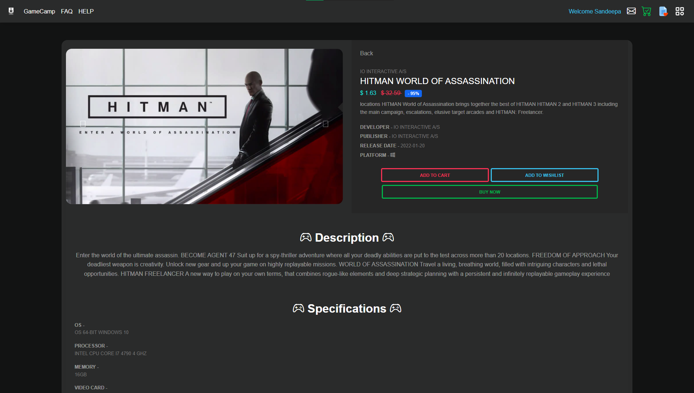
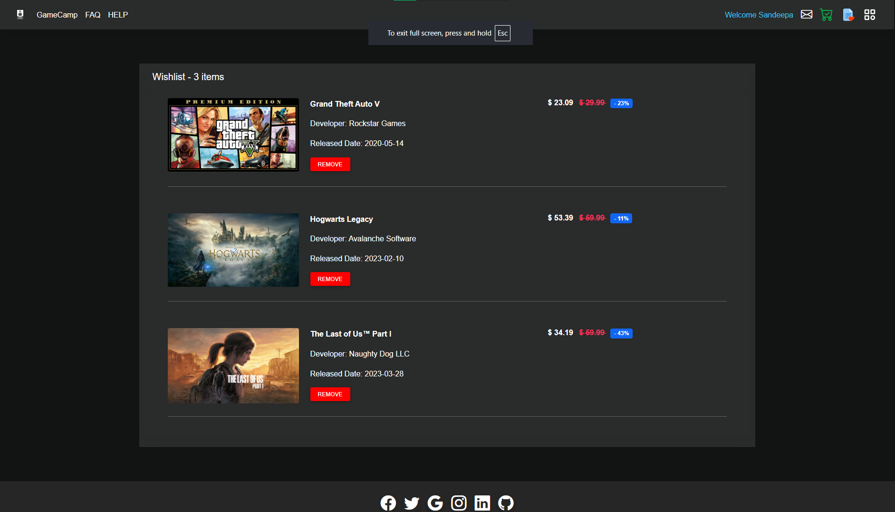

# 🎮 GameCamp Store

GameCamp Store is a PHP and MySQL-based online game store application built with a focus on game browsing, user accounts, wishlist functionality, shopping and checkout workflows, invoice generation, and online payments.

The project is designed to run locally using **XAMPP** and uses **MySQL** for data storage.

---

## ✨ Features

* 🎮 Browse available games
* 🔎 Search and view game details
* 👤 User registration and login
* 🔐 User authentication and session management
* 🛒 Game purchasing workflow
* ❤️ Wishlist functionality
* 💳 Stripe payment integration
* 🧾 Invoice generation
* 📧 Email functionality using PHPMailer
* 🗄️ MySQL database integration
* 📦 Composer dependency management
* 📱 Responsive interface using Bootstrap/MDB
* 🖼️ Game images and product information
* 💰 Game pricing and discount support
* 🛠️ Admin-related functionality
* 🔒 Environment-based configuration for sensitive credentials

---

## 🛠️ Technologies Used

### Backend

* PHP
* MySQL
* PDO / MySQLi
* PHP Sessions

### Frontend

* HTML5
* CSS3
* JavaScript
* Bootstrap
* MDB (Material Design for Bootstrap)

### Payment

* Stripe PHP SDK

### Email

* PHPMailer

### Dependency Management

* Composer

### Development Environment

* XAMPP
* Apache
* MySQL
* phpMyAdmin

---

## 📁 Project Structure

A simplified overview of the project structure:

```text
gamecampstore/
│
├── database/
│   └── gamecamp_db.sql
│ 
├── resources/
│   ├── banner/
│   ├── Corousel/
│   ├── game_images/
│   └── profile_images/

│
├── vendor/
│   └── ...
│
├── connection.php
├── checkout.php
├── buyNow.php
├── createInvoiceProcess.php
├── wishlist.php
├── adminVerificationProcess.php
├── composer.json
├── composer.lock
├── .env
├── .gitignore
└── README.md
```

> The actual project contains additional PHP files, assets, libraries, and application components.

---

## 📋 Requirements

Before running the project, install the following:

* PHP 8.x or compatible PHP version
* Apache
* MySQL
* XAMPP
* Composer
* Modern web browser
* Stripe account for payment functionality
* SMTP/email account for email functionality

---

# 🚀 Installation

## 1. Clone the Repository

Clone the project into your XAMPP `htdocs` directory:

```bash
cd C:\xampp\htdocs
git clone https://github.com/dinuja-sandeepa/gamecampstore.git
```

Then enter the project directory:

```bash
cd gamecampstore
```

Alternatively, if the repository has already been cloned, simply open the existing project directory.

---

## 2. Start XAMPP

Open the XAMPP Control Panel and start:

* Apache
* MySQL

Make sure both services are running successfully.

---

## 3. Create the Database

Open phpMyAdmin:

```text
http://localhost/phpmyadmin
```

Create a database named:

```text
gamecamp_db
```

Then import:

```text
database/gamecamp_db.sql
```

into the newly created database.

---

## 4. Install Composer Dependencies

From the project directory, run:

```bash
composer install
```

This installs the dependencies defined in:

```text
composer.json
```

The project also includes the `vendor/` directory, but running `composer install` ensures the installed dependencies match the project's Composer configuration.

---

# 🔐 Environment Configuration

Sensitive credentials should **not** be hardcoded directly into PHP source files.

Create a `.env` file in the project root.

Example:

```env
DB_HOST=localhost
DB_USER=root
DB_PASSWORD=your_database_password
DB_NAME=gamecamp_db
DB_PORT=3306

STRIPE_SECRET_KEY=your_stripe_secret_key

MAIL_PASSWORD=your_mail_password
```

Use the actual values appropriate for your local environment.

### Important

Never commit your `.env` file to GitHub.

The project `.gitignore` is configured to exclude it:

```gitignore
.env
```

Do not publish:

* Database passwords
* Stripe secret keys
* Email passwords
* API keys
* Private keys
* Other application secrets

---

# 💳 Stripe Configuration

GameCamp Store uses the Stripe PHP SDK for payment processing.

The Stripe secret key should be stored in `.env`:

```env
STRIPE_SECRET_KEY=your_stripe_secret_key
```

PHP code reads the value from the environment configuration rather than storing the secret directly in the source code.

For example:

```php
$env = parse_ini_file(__DIR__ . '/.env');

$stripe = new \Stripe\StripeClient(
    $env['STRIPE_SECRET_KEY']
);
```

### Stripe Testing

For development, use Stripe's test environment and test API credentials.

Do not use production credentials during local development.

---

# 📧 Email Configuration

The project uses **PHPMailer** for email functionality.

Configure the required mail credentials in `.env`:

```env
MAIL_PASSWORD=your_mail_password
```

Other SMTP settings can be configured according to the email provider being used.

Never hardcode email passwords or application passwords inside PHP files.

---

# 🌐 Running the Application

After starting Apache and MySQL in XAMPP, open:

```text
http://localhost/gamecampstore/
```

The application should load through the Apache web server.

---

# 🗄️ Database

The application uses MySQL for storing application data.

The database export is located at:

```text
database/gamecamp_db.sql
```

The database contains the application's required tables and schema.

Before using the application, make sure:

1. MySQL is running.
2. `gamecamp_db` exists.
3. The SQL file has been imported.
4. Database credentials in `.env` are correct.

---

# 🧩 Dependencies

The project uses Composer to manage PHP dependencies.

Composer configuration is stored in:

```text
composer.json
```

The dependency lock file is:

```text
composer.lock
```

Installed packages are available under:

```text
vendor/
```

To install or restore dependencies:

```bash
composer install
```

To update dependencies:

```bash
composer update
```

> Updating dependencies may introduce compatibility changes. For reproducible installations, prefer `composer install`.

---

# 🔒 Security

Security-sensitive configuration is intentionally separated from application source code.

The following should never be committed to a public repository:

```text
.env
```

or files containing:

* Passwords
* API keys
* Secret keys
* SMTP credentials
* Database credentials
* Private certificates
* Authentication tokens

Before pushing changes to GitHub, check your files for accidentally exposed credentials.

---

# 🧪 Development

For local development:

```text
XAMPP
 ├── Apache
 └── MySQL
```

Project location:

```text
C:\xampp\htdocs\gamecampstore
```

Application URL:

```text
http://localhost/gamecampstore/
```

---

# 🔄 Updating the Project

After making changes:

```bash
git status
```

Review the modified files.

Then:

```bash
git add .
```

Commit the changes:

```bash
git commit -m "Describe your changes"
```

Push them to GitHub:

```bash
git push
```

---

# ⚠️ Important Development Notes

### Local URLs

Some application URLs may currently reference the local XAMPP environment, for example:

```text
http://localhost/gamecampstore/
```

Before deploying the application to a production server, update these URLs to the production domain where necessary.

### Payment Configuration

Stripe configuration should be reviewed before production deployment.

Make sure production credentials, webhook configuration, success URLs, cancel URLs, and other payment settings are correctly configured for the production environment.

### Database Credentials

Do not use development database credentials in a production environment.

Create appropriate production database credentials and configure them through environment variables.

---

# 📸 Screenshots

Screenshots can be added to this section to showcase the application.

Example:

## 📸 Screenshots

### Homepage


### Game Details



### Wishlist




Recommended screenshots:

* Homepage
* Game listing
* Game details
* Login/Register
* Wishlist
* Checkout
* Invoice
* Admin interface

---

# 🗺️ Future Improvements

Potential improvements for future versions include:

* Improved product filtering and sorting
* Enhanced search functionality
* Improved admin dashboard
* Order history
* Improved payment workflow
* Payment webhook handling
* Better email notification system
* User profile management
* Improved security and validation
* Production deployment configuration
* Automated testing
* Improved error handling and logging
* Performance optimization
* Responsive UI improvements

---

# 📄 License

This project is currently provided without a specified open-source license.

If you intend to allow others to use, modify, or redistribute the project, add an appropriate license such as the MIT License or another license that matches your intended usage.

---

# 👨‍💻 Author

**Dinuja Sandeepa**

GitHub:

```text
https://github.com/dinuja-sandeepa
```

---

## ⭐ Project

If you find this project useful, you can star the repository on GitHub.

Repository:

```text
https://github.com/dinuja-sandeepa/gamecampstore
```
